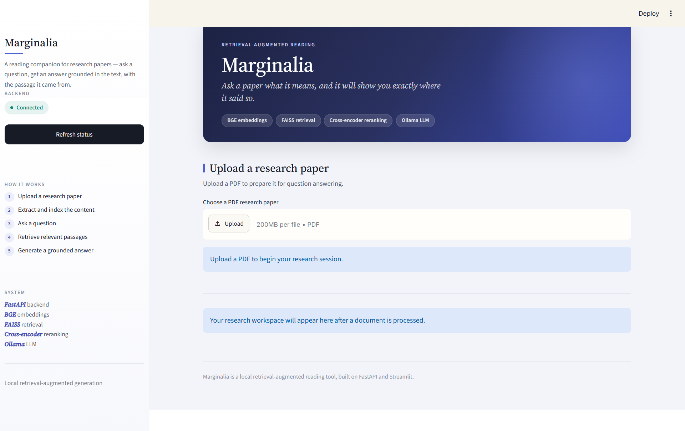
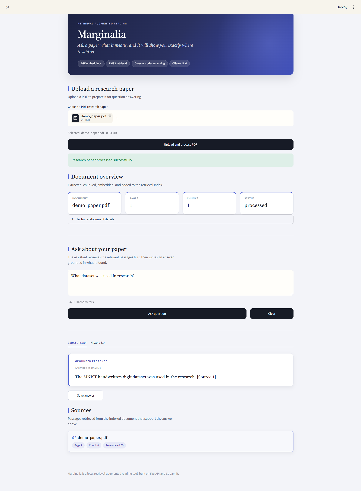

# AI Research Assistant

An open-source AI research assistant that uses **Retrieval-Augmented Generation (RAG)** to help users search, understand, and analyze research papers.

The system accepts research-paper PDFs, extracts and chunks their text, creates semantic embeddings, retrieves relevant passages, reranks them using a cross-encoder, and generates grounded answers using a local LLM through Ollama.

---

## Table of Contents

- [Project Status](#project-status)
- [Screenshots](#screenshots)
- [Architecture](#architecture)
- [How RAG Works](#how-rag-works)
- [Technology Stack](#technology-stack)
- [API](#api)
- [Retrieval and Reranking](#retrieval-and-reranking)
- [Grounded Citations](#grounded-citations)
- [Retrieval Evaluation](#retrieval-evaluation)
- [Testing](#testing)
- [Project Structure](#project-structure)
- [Local Development](#local-development)
- [Data and Generated Files](#data-and-generated-files)
- [Current Limitations](#current-limitations)

---

## Project Status

**Working prototype** — the core RAG pipeline and REST API are implemented and tested.

### Current capabilities

- PDF document upload and ingestion
- Page-level text extraction
- Overlapping text chunking
- BGE semantic embeddings
- FAISS vector search
- Cross-encoder reranking
- Retrieval relevance filtering
- Grounded question answering
- Source citations
- Multi-document retrieval
- REST API with FastAPI
- Automated testing and retrieval evaluation

---

## Screenshots

| | |
| :---: | :---: |
|  |  |
| *Upload a PDF — the document is extracted, chunked, embedded, and indexed. Statistics show pages, chunks, and status.* | *Ask a question — relevant passages are retrieved, reranked, and used to generate a grounded answer with citations.* |
| | |
|  |  |
| *Question history with expandable citations showing source document, page, chunk, and relevance score.* | *Full Streamlit web interface showing the Marginalia reading companion.* |

---

## Architecture

```text
PDF
 │
 ▼
Document Ingestion
 │
 ▼
Text Extraction
 │
 ▼
Chunking
 │
 ▼
BGE Embeddings
 │
 ▼
FAISS Vector Store
 │
 ▼
Semantic Retrieval
 │
 ▼
Cross-Encoder Reranking
 │
 ▼
Relevance Filtering
 │
 ▼
Local LLM (Ollama)
 │
 ▼
Grounded Answer + Citations
```

---

## How RAG Works

The system uses a **Retrieval-Augmented Generation (RAG)** pipeline to answer questions about indexed research papers.

| Step | Description |
|------|-------------|
| 1 | A research-paper PDF is uploaded to the API. |
| 2 | The PDF is converted into page-level text. |
| 3 | Text is divided into overlapping chunks. |
| 4 | Each chunk is converted into a semantic embedding using a BGE embedding model. |
| 5 | Embeddings are stored in a FAISS vector index. |
| 6 | A user's question is converted into an embedding. |
| 7 | FAISS retrieves candidate chunks based on semantic similarity. |
| 8 | A cross-encoder reranker reorders the retrieved candidates by relevance. |
| 9 | Low-relevance results can be filtered. |
| 10 | The most relevant context is provided to a local LLM through Ollama. |
| 11 | The LLM generates an answer grounded in the retrieved context. |
| 12 | Document and page information is returned as citations. |

The system is designed to reduce unsupported answers by instructing the LLM to rely only on retrieved research context. When relevant information cannot be found in the indexed documents, the system returns an insufficient-context response instead of fabricating an answer.

---

## Technology Stack

| Category | Technology |
|----------|------------|
| Language | **Python** — application and RAG pipeline |
| API Framework | **FastAPI** — REST API |
| PDF Processing | **PyMuPDF** — PDF text extraction |
| Embeddings & Reranking | **Sentence Transformers** — semantic embeddings and reranking |
| Embedding Model | **BAAI/bge-small-en-v1.5** |
| Vector Search | **FAISS** — vector similarity search |
| Reranking Model | **cross-encoder/ms-marco-MiniLM-L-6-v2** |
| LLM Runtime | **Ollama** — local LLM runtime |
| LLM Model | **llama3.2:3b** — local language model |
| Validation | **Pydantic** — request/response validation |
| Testing | **Pytest** — automated testing |

---

## API

The application exposes a REST API through FastAPI.

### Start the API

```bash
python -m uvicorn app.main:app --reload
```

The API will be available at: `http://127.0.0.1:8000`

Interactive API documentation (Swagger UI): `http://127.0.0.1:8000/docs`

### Endpoints

#### Health Check
```http
GET /health
```
```json
{ "status": "healthy" }
```

#### Upload a Research Paper
```http
POST /documents/upload
```
Accepts PDF files with:
- File type validation
- Empty file rejection
- 20 MB upload limit
- Page text extraction
- Chunking and BGE embedding generation
- FAISS vector store update

#### Ask a Question
```http
POST /ask
```
**Request:**
```json
{
  "question": "What dataset was used to train the model?",
  "top_k": 5,
  "final_k": 5
}
```

**Response:**
```json
{
  "answer": "The model uses a transformer architecture with self-attention.",
  "citations": [
    {
      "source_id": 0,
      "document_name": "research_paper.pdf",
      "page_number": 3,
      "chunk_id": 12,
      "score": 0.87
    }
  ]
}
```

---

## Retrieval and Reranking

The retrieval system uses a **two-stage approach**:

### Stage 1 — Semantic Retrieval
The BGE embedding model converts both documents and questions into vectors. FAISS then performs similarity search to retrieve the most relevant candidate chunks.

### Stage 2 — Cross-Encoder Reranking
The retrieved candidates are passed to a cross-encoder:

```
cross-encoder/ms-marco-MiniLM-L-6-v2
```

The cross-encoder evaluates the relationship between the user's question and each retrieved chunk and produces a relevance score. This improves the ordering of retrieved context before sending it to the LLM.

---

## Grounded Citations

Answers include citation metadata associated with the retrieved chunks:

- Document name
- Page number
- Chunk ID
- Retrieval/reranking score

This provides traceability from an answer back to the source material used to generate it.

---

## Retrieval Evaluation

The project includes evaluation scripts and tests for measuring retrieval quality.

**Metrics tracked:**
- Top-1 accuracy
- Top-3 accuracy
- Mean Reciprocal Rank (MRR)

The project also evaluates the cross-encoder reranking stage. These evaluations compare retrieval behavior and identify cases where semantically related but incorrect chunks are retrieved.

---

## Testing

Run the complete test suite:

```bash
python -m pytest
```

**Test coverage:**
- API endpoints
- PDF loading
- Text chunking
- Embeddings
- Vector-store behavior
- Retrieval
- RAG pipeline behavior
- Citation generation
- Relevance filtering
- Retrieval evaluation
- Reranking evaluation

---

## Project Structure

```
AI-Research-Assistant/
│
├── app/
│   ├── api/
│   │   └── routes.py
│   ├── chunking/
│   │   └── chunker.py
│   ├── embeddings/
│   │   └── service.py
│   ├── ingestion/
│   │   ├── pdf_loader.py
│   │   ├── schemas.py
│   │   └── service.py
│   ├── rag/
│   │   └── pipeline.py
│   ├── retrieval/
│   │   └── reranker.py
│   ├── vector_store/
│   │   └── faiss_store.py
│   └── main.py
│
├── scripts/
│   ├── build_bge_index.py
│   ├── check_retrieval.py
│   ├── check_reranking.py
│   └── run_rag_demo.py
│
├── tests/
│   ├── test_api.py
│   ├── test_chunker.py
│   ├── test_embeddings.py
│   ├── test_pdf_loader.py
│   ├── test_rag_pipeline.py
│   ├── test_retriever.py
│   ├── test_vector_store.py
│   ├── test_citations.py
│   ├── test_relevance_filtering.py
│   ├── test_retrieval_evaluation.py
│   └── test_reranking_evaluation.py
│
├── data/
│   └── .gitkeep
│
├── screenshots/
│   ├── 1.png
│   ├── 3.png
│   ├── 4.png
│   └── 5.png
│
├── requirements.txt
├── .gitignore
└── README.md
```

---

## Local Development

### Prerequisites
- Python 3.10+
- Ollama installed and running with `llama3.2:3b` model

### Setup

```bash
# Create and activate virtual environment
python -m venv .venv
.venv\Scripts\Activate.ps1   # Windows PowerShell
# source .venv/bin/activate   # Linux/macOS

# Install dependencies
pip install -r requirements.txt

# Start Ollama (separate terminal)
ollama serve
ollama pull llama3.2:3b

# Start FastAPI application
python -m uvicorn app.main:app --reload
```

### Run Streamlit UI (optional)

```bash
streamlit run streamlit_app.py
```

---

## Data and Generated Files

Generated application data is intentionally excluded from Git:

- Uploaded PDFs
- Generated embeddings
- FAISS indexes
- Vector-store metadata

These files are stored under the `data/` directory during local development and are ignored by Git.

---

## Current Limitations

This is a research-oriented prototype. Planned capabilities not yet implemented:

- Advanced research-paper summarization
- Comprehensive multi-user document management
- Production deployment
- Large-scale evaluation datasets

---

## License

MIT License — see [LICENSE](LICENSE) for details.